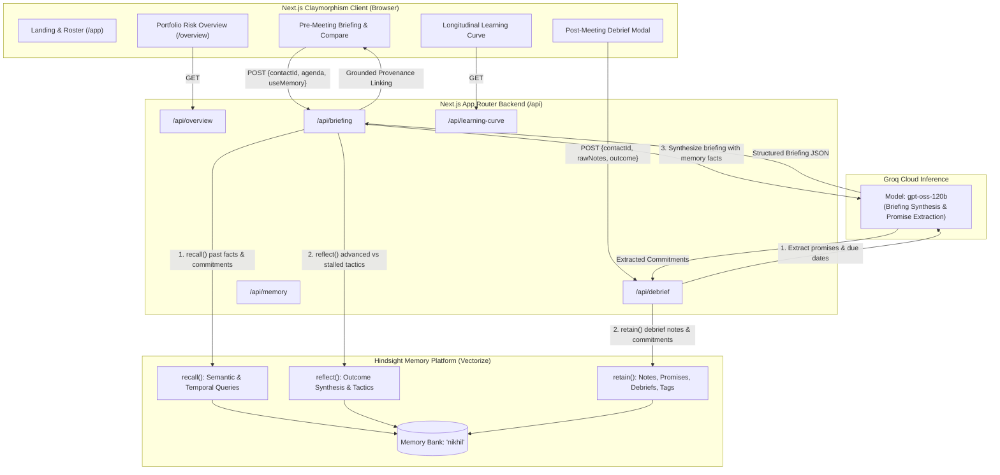
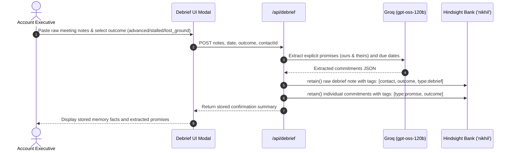
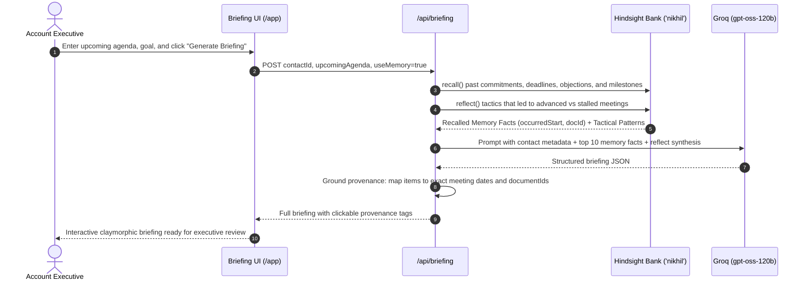

# Meeting Prep Agent: Persistent Relationship Intelligence

> An executive meeting preparation system powered by **Vectorize Hindsight** persistent memory banks and **Groq** high-speed inference. Never walk into a meeting having forgotten a past commitment, unresolved objection, or shifting stakeholder sentiment.

---

## Architecture Overview

Meeting Prep Agent sits on top of two core backbones:
1. **Vectorize Hindsight (`@vectorize-io/hindsight-client`)**: Acts as the agent's persistent hippocampus, storing structured facts, temporal metadata, entity relationships, and synthesis patterns across discussions.
2. **Groq (`groq-sdk`)**: Provides low-latency reasoning and synthesis using open-weight models (`openai/gpt-oss-120b`).



---

## Memory Retain and Recall Lifecycle

### 1. Retain Flow (After Every Meeting)


### 2. Recall Flow (Before Upcoming Meetings)


---

## Core Capabilities

1. **Portfolio Risk Overview (`/overview`)**:
   - Ranks all 4 active enterprise accounts by risk (`#1 Elena Rostova` Critical, `#2 Amara Chen` High, `#3 Devon Miller` Moderate, `#4 Marcus Vance` Low/Expanding).
   - Displays real-time relationship status, count of documented broken promises, and next recommended actions with target deadlines.
   - Clicking any row opens that contact's pre-meeting briefing directly.

2. **Longitudinal Learning Curve (`/app?tab=learning-curve`)**:
   - Demonstrates how relationship intelligence compounds across 3 historical memory thresholds for the same upcoming agenda:
     - **Stage 1 (Before 1st meeting)**: 0 promises, 0 risks, 0 open questions (cold baseline).
     - **Stage 2 (Before 4th meeting)**: 2 promises, 1 risk, 2 questions (early technical traction).
     - **Stage 3 (Before 7th meeting)**: 5 promises, 3 risks, 3 questions (crisis, Confluent fallback threat, MSA liability redlines).
   - Pre-generated cache for instant (<5ms) demo loading.

3. **Side-by-Side Memory Contrast**:
   - One-click side-by-side briefing comparison showing the difference between memory-augmented intelligence and generic zero-memory responses.

4. **Provenance Tracking**:
   - Every promise, unresolved question, and sensitivity links back to the source meeting note in the timeline via small clickable labels (`Source: Aug 14 meeting`).

5. **Post-Meeting Debrief & Reflection**:
   - Ingests unstructured meeting notes, extracts promises using Groq, retains memories tagged with outcomes (`advanced`, `stalled`, `lost_ground`), and queries Hindsight `reflect()` to guide future tactics.

---

## Setup and Installation

### 1. Prerequisites
- **Node.js**: `v18.0.0` or higher (`v24.x` recommended)
- **npm**: `v9.x` or higher
- **Hindsight API Key & Bank**: Obtainable from [vectorize.io](https://hindsight.vectorize.io/)
- **Groq API Key**: Obtainable from [console.groq.com](https://console.groq.com/)

### 2. Clone and Install Dependencies
```bash
git clone <repository-url>
cd meeting-prep-agent
npm install
```

### 3. Configure Environment Variables
Copy the example environment file:
```bash
cp .env.local.example .env.local
```

Edit `.env.local` with your credentials:
```env
# Vectorize Hindsight API Configuration
HINDSIGHT_ENDPOINT=https://api.hindsight.vectorize.io
HINDSIGHT_API_KEY=your_hindsight_api_key_here
HINDSIGHT_BANK_ID=nikhil

# Groq Cloud API Configuration
GROQ_API_KEY=your_groq_api_key_here
GROQ_MODEL=openai/gpt-oss-120b
```

> **Security Note:** `.env.local` is explicitly ignored in `.gitignore` and must never be committed to source control.

### 4. Run the Development Server
```bash
npm run dev
```

Open [http://localhost:3000](http://localhost:3000) in your browser.

- **Landing Page**: [http://localhost:3000](http://localhost:3000)
- **Portfolio Risk Overview**: [http://localhost:3000/overview?demo=true](http://localhost:3000/overview?demo=true)
- **Main Workspace**: [http://localhost:3000/app?demo=true](http://localhost:3000/app?demo=true)

---

## Error Handling Architecture

Meeting Prep Agent includes end-to-end graceful degradation and structured error handling for external dependencies:

| Failure Mode | Detection | Backend Handling | UI Message & Action |
| :--- | :--- | :--- | :--- |
| **Groq TPM/RPM Rate Limit (429)** | Catches 429 / `rate_limit_exceeded` | Returns `{ service: 'groq', statusCode: 429, error: '...' }` | Renders a terracotta alert banner advising the user to wait 10 seconds or click **"Try Without Memory (Lightweight Prompt)"** to bypass token limits. |
| **Groq Service Outage / Invalid Key** | Catches 5xx or auth failures | Returns `{ service: 'groq', statusCode: 502, error: '...' }` | Clear error banner identifying Groq LLM failure with diagnostic logs and retry button. |
| **Hindsight Bank Connection Failure** | Catches recall rejection or network timeout | Returns `{ service: 'hindsight', statusCode: 502, error: '...' }` | Soft brick alert banner identifying Hindsight Memory Bank failure, recommending verification of `HINDSIGHT_API_KEY`. |
| **Post-Meeting Debrief Failure** | Catches extraction or retention errors | Returns `{ service: 'hindsight' \| 'groq', ... }` | Inline error box inside the Debrief modal allowing the user to edit notes or retry without losing inputs. |

---

## Running the Automated Test Suite

The project includes unit and integration tests covering the briefing route with and without memory, parameter validation, and error states using Node's native test runner:

```bash
npm test
```

### Test Coverage Breakdown
- `POST /api/briefing` missing `contactId` &rarr; 400 Bad Request
- `POST /api/briefing` non-existent contact &rarr; 404 Not Found
- `POST /api/briefing` **Without Memory** (`useMemory: false`) &rarr; 200 OK, zero recalled memories, intentional fallback placeholders displayed for sentiment and commitments
- `POST /api/briefing` **With Memory** (`useMemory: true`) &rarr; 200 OK, verified Hindsight facts recalled, commitments extracted with provenance metadata (`sourceDate`, `sourceDocumentId`)

---

## Design System: Claymorphism

The application adheres to a restrained enterprise **Claymorphism** aesthetic:
- **Palette**: Warm sand background (`#e6dfd3`), molded clay surfaces (`#eee8dc`), terracotta accent (`#b8623f`), muted sage (`#7d9080`), and near-black warm body text (`#2a2622`).
- **Surfaces**: 20px to 28px border radii, multi-layered warm drop shadows with inner top-left highlights and bottom-right shades.
- **Typography**: Source Serif 4 for headings, Source Sans 3 for body.
- **Integrity**: Strict zero-emoji, zero-em-dash policy; hand-crafted inline SVG icons.
